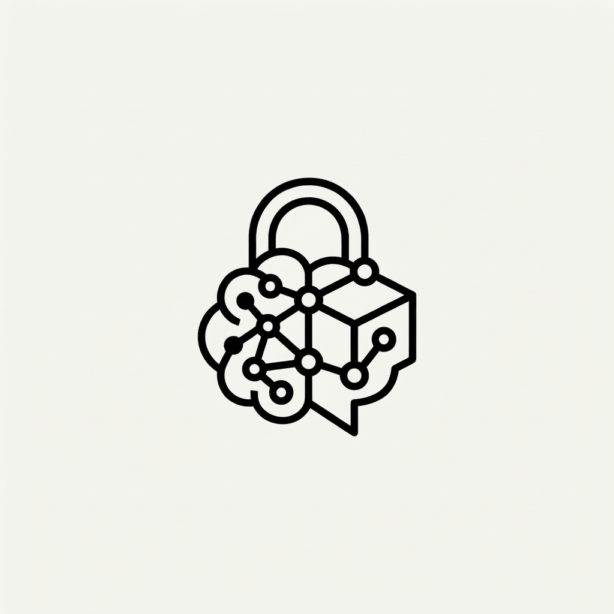

<div align="center">
  

  # Ramoosh | رموش

  **A friendly cryptography assistant, with tools that run in your browser.**

  Encrypt and decrypt messages, create hashes, and compress text — with an AI assistant to help you find the right tool.

  [Getting started](#getting-started) · [How it works](#how-it-works) · [Privacy and security](#privacy-and-security) · [Deployment](#deployment)
</div>

---

Ramoosh is a bilingual Persian and English prototype for exploring everyday cryptography. Open a tool directly, or describe what you want to do in the chat and let the assistant open the appropriate form. The sensitive inputs you enter in those forms are processed locally in your browser.

> **Keep secrets out of the chat.** Chat messages are sent to the server and the configured AI provider. Enter messages, passphrases, and keys only in the local tool forms.

## Features

| Tool | What it does |
| --- | --- |
| **Encrypt and decrypt** | Use AES-256-GCM with a passphrase or RSA-OAEP-SHA-256 with public and private keys. Generate RSA key pairs in the browser. |
| **Hash text** | Create SHA-256, SHA-384, or SHA-512 digests, displayed in hexadecimal. |
| **Compress and decompress** | Use GZIP or DEFLATE to convert text to and from Base64-encoded compressed data. |
| **Chat-assisted tools** | Ask the assistant to open an operation and, optionally, a supported algorithm. Responses stream into the conversation. |
| **Manual tools** | Access the same local operations without using the assistant or configuring an AI provider. |

The interface also includes Persian and English language options, light and dark themes, and voice input where supported by the browser.

## How it works

```text
You ──> chat ──> /api/chat ──> Groq (OpenAI-compatible API)
          │                         │
          └──── opens local form <──┘
                       │
                       └──> browser processes your form input locally
```

The assistant selects an operation; it does not need your message or passphrase to do so. The React interface performs encryption, decryption, and hashing using Web Crypto, and compression using the browser's Compression Streams API. The `/api/chat` server endpoint keeps the provider API key on the server.

For example, ask “Open the AES encryption tool,” then enter your message and passphrase in the form that appears. Save the entire encrypted output. To decrypt it later, use that output and the same passphrase.

## Getting started

### Prerequisites

- Node.js **22 or later** and npm.
- A browser with Web Crypto support, running on HTTPS or localhost. Compression also requires the Compression Streams API.
- A Groq API key if you want to use chat. Manual tools work without one.

### Install and run

```bash
git clone https://github.com/AliKarimi1384/ramoosh.git
cd ramoosh
npm ci
```

The current chat provider is Groq, using its OpenAI-compatible API. To enable the assistant, create `.env.local` in the project root with your Groq API key:

```dotenv
GROQ_API_KEY=your_groq_api_key
# GROQ_MODEL=qwen/qwen3.8-27b
```

Never commit your real API keys.

```bash
npm run dev
```

Open the address printed in the terminal. The development server starts at `http://127.0.0.1:3000` and tries subsequent ports if needed. It serves both the frontend and `/api/chat`; opening `index.html` directly is not enough. The server loads `.env.local`, or `.env` if `.env.local` does not exist.

### Configuration

| Variable | Purpose |
| --- | --- |
| `GROQ_API_KEY` | Groq API key for the assistant. |
| `GROQ_MODEL` | Groq model; defaults to `qwen/qwen3.8-27b`. |
| `GROQ_BASE_URL` | Optional OpenAI-compatible API base URL. |
| `PORT` | Starting port for the local development server; defaults to `3000`. |

Choose a model available to your account that supports tool calling. Configuration belongs on the server, not in browser code.

## Using the tools

1. Open **Manual tools**, or ask the assistant to open an operation.
2. Select the operation and algorithm, then enter your input in its local form.
3. Copy and store the result. For decryption, retain the complete encrypted output and the corresponding passphrase or private key. For decompression, retain the Base64 output and the algorithm used.

AES derives a key from the passphrase with PBKDF2-SHA-256 and generates a fresh random salt and IV for each message. Ramoosh can decrypt its versioned `rm1` and `rm2` formats. A forgotten passphrase cannot be recovered.

For RSA, encrypt with the recipient's public key and decrypt with the corresponding private key. Generated keys use PEM; legacy JWK keys are also accepted. Direct encryption with a generated 2048-bit key supports messages up to **190 UTF-8 bytes**, which may be fewer than 190 characters. Generated keys are cleared when the page reloads, so save them safely.

Hashing is one-way and cannot be decrypted. Compression is not encryption. Compression and decompression support up to 1,000,000 bytes of input text or decompressed text, respectively.

## Privacy and security

- Inputs entered in the dedicated tool forms are processed in the browser. Chat messages go to the server and the configured model provider, so do not put confidential text, passphrases, private keys, or API keys in chat.
- Keep private keys secret. Share an AES passphrase through a separate secure channel from the encrypted message.
- Security depends on a strong passphrase, a trusted device, and trustworthy deployed code. Use HTTPS outside local development.
- Ramoosh is a prototype. Before a public deployment, add appropriate authentication, rate and cost controls, monitoring, a privacy policy, and a security review. An unrestricted chat endpoint can consume your API quota.

## Development

| Command | Purpose |
| --- | --- |
| `npm run dev` | Start the frontend and local chat API. |
| `npm test` | Run the Node.js test suite. |
| `npm run build` | Type-check and build the frontend into `dist/`. |
| `npm run preview` | Preview the built frontend with Vite; this does not serve the chat API. |

```text
src/          React interface, translations, and chat presentation
lib/          Cryptography, compression, and chat/network helpers
api/chat.js   Server endpoint for the AI assistant
scripts/      Local development server
test/         Automated tests
```

## Deployment

The included Vercel configuration builds the Vite frontend into `dist/` and deploys `api/chat.js` as a serverless function.

1. Import the repository into Vercel.
2. Set `GROQ_API_KEY` in the project's environment variables and optionally set `GROQ_MODEL`.
3. Deploy, then check the assistant and an encryption/decryption round trip. Redeploy after changing environment variables.

See Vercel's guides for [Git deployments](https://vercel.com/docs/git) and [environment variables](https://vercel.com/docs/environment-variables/managing-environment-variables).

## License

Ramoosh is available under the [Apache License, Version 2.0](LICENSE).
